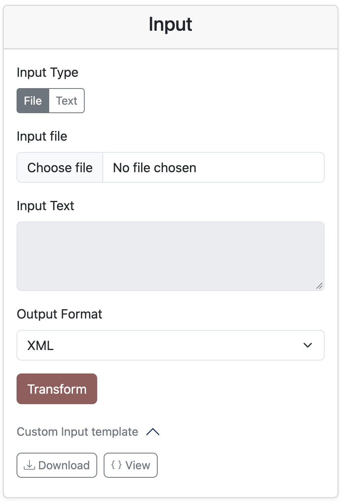
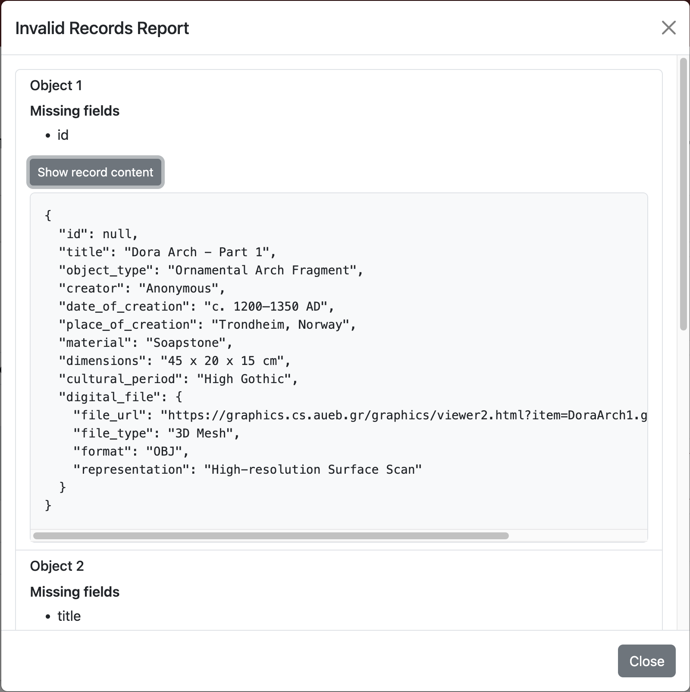
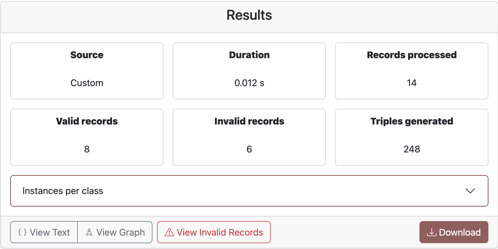

# Heritage Metadata Transformation

The [Heritage Metadata Transformation tool](https://isdb.cs.aueb.gr/hdto/) converts cultural heritage metadata into RDF according to the **Heritage Digital Twin Ontology (HDTO)**. RDF is a standard format for representing information and connections between things. The tool recognizes supported metadata sources, checks records for required information, and transforms them into RDF that you can inspect or download.

This guide explains how to use the web interface. You do not need to install anything or know how the project is built.

## Use the interface

1. Open the [tool](https://isdb.cs.aueb.gr/hdto/). The page has an **Input** panel and a **Results** panel.
2. Choose how to provide your metadata:
   - Choose **File** and select a JSON file from your device. The file can contain one record or a JSON array of records.
   - Choose **Text** and paste JSON directly into the text area.
3. Choose an **Output Format**:
   - **XML** creates RDF/XML.
   - **Turtle** creates Turtle RDF.
   
4. Select **Transform**. The tool detects the source format, checks required fields, and creates the RDF output.
5. Review the **Results** summary. It shows the detected source, processing duration, records processed, valid and invalid records, and triples generated. If shown, **Instances per class** gives a count of the different HDTO classes in the result.
6. Explore the result:
   - Select **View Text** to read the generated RDF.
   - Select **View Graph** to see the resources and relationships as a diagram. You can move around the graph and use **Fit graph** to bring it back into view.
   - If there are invalid records, select **View Invalid Records** to see each record’s number, missing fields, and original content.
   
7. Select **Download** to save the generated RDF file. XML downloads as `.rdf`; Turtle downloads as `.ttl`.
   

## What input can I use?

The tool accepts valid JSON records from these sources:

- **Europeana Record API**
- **Digital Public Library of America (DPLA) API**
- **Custom** records using the custom input format

The tool detects the source automatically, so there is no source menu to choose from. If you submit multiple records, make sure they are all from the same source. The tool checks each record: it transforms records that contain the required information and lists records with missing information under **View Invalid Records**.

### Using the custom input template

If you do not have a Europeana or DPLA record, the page provides a **Custom Input template** in the Input panel:

1. Expand **Custom Input template**.
2. Select **View** to see the example in the browser, or **Download** to save a copy.
3. Replace the example values with your record’s values, keeping the same JSON field names and structure.
4. Make sure `id`, `title`, and `digital_file.file_url` have values. The example below also includes optional descriptive fields:

   ```json
   {
     "id": "object-001",
     "title": "Ancient Greek vase",
     "object_type": "Amphora",
     "creator": "Unknown potter",
     "date_of_creation": "5th century BCE",
     "place_of_creation": "Athens, Greece",
     "material": "Terracotta",
     "dimensions": "Height: 35 cm; diameter: 22 cm",
     "cultural_period": "Classical Greece",
     "digital_file": {
       "representation": "ancient-greek-vase.glb",
       "file_type": "3D model",
       "format": "glTF",
       "file_url": "https://example.org/files/ancient-greek-vase.glb"
     }
   }
   ```

5. Submit the edited JSON using **File** or **Text** as described above.

The template is an example to edit, not a record that is guaranteed to pass validation as downloaded.

## If something goes wrong

- **The input is not accepted:** Check that the text or file is valid JSON and that its records come from one supported source.
- **The source is not supported:** Use a Europeana record, a DPLA record, or format the record using the custom input template.
- **Some records are invalid:** Select **View Invalid Records** and use the missing-field list to correct those records. Then submit the corrected input again.
- **No output is generated:** Check the input and required fields, then try the transformation again.